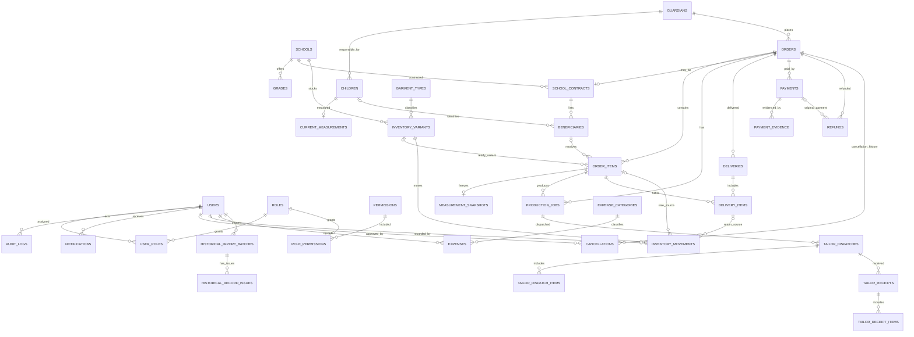

# تصميم قاعدة البيانات — للمراجعة قبل إنشاء القاعدة

**الحالة:** التصميم المنطقي مع migrations للتطوير والاختبارات. لا توجد قاعدة بيانات تشغيلية؛ migrations تُشغّل فقط داخل اختبارات SQLite in-memory حتى الآن.  
**المرجع:** `SRS.md` المعتمدة، الإصدار 1.0.

## مبادئ التصميم

- قاعدة علائقية، مع مفاتيح أساسية داخلية غير مشتقة من الأسماء، وقيود FK وUnique وCheck.
- كل المبالغ `DECIMAL(15,2)` بعملة SDG، ولا تستخدم float في الحسابات. التقريب والعرض يكونان في طبقة المجال.
- جميع timestamps محفوظة بصيغة UTC عبر `APP_TIMEZONE=UTC`؛ توقيت العرض `APP_DISPLAY_TIMEZONE=Africa/Khartoum`. تواريخ العمليات المالية/التشغيلية هي تواريخ المشغل المحلية، ويُحفظ التاريخ الأصلي للسجلات المستوردة متى توفر.
- لا حذف مادي للسجلات المالية أو حركات المخزون. التصحيح حركة عكسية/سجل تصحيح جديد مع السبب والمعتمد.
- تحديثات الطلب/الدفع/المخزون والتسليم تنفذ ضمن معاملات DB، وتُقفل صفوف رصيد الصنف عند الخصم لمنع بيع متزامن يتجاوز المتاح.
- لا تخزن المستند المالي في مجلد عام. جدول المرفقات يحمل مفتاح تخزين خاصاً وبيانات MIME/الحجم/بصمة الملف، ويقدم الملف بعد تفويض خادمي.
- سجل التدقيق append-only من تطبيق النظام، بلا واجهة تعديل/حذف. يفضل DB user للتطبيق بلا صلاحية حذف السجل، مع صلاحيات صيانة منفصلة.

## مخطط العلاقات المنطقي

## الكيانات والقيود الأساسية

### الهوية والصلاحيات

- `users`: اسم المستخدم فريد، البريد اختياري وفريد إن وجد، كلمة مرور hash فقط، حالة التفعيل، بيانات آخر دخول. تسجيل الدخول يقبل اسم المستخدم أو البريد.
- `roles`, `permissions`, `user_roles`, `role_permissions`: RBAC مركزي متعدد الأدوار؛ تحقق الخادم من permission لكل action، ولا يثق بواجهة المستخدم.
- `audit_logs`: المستخدم، وقت UTC، العملية، نوع/معرف الكيان، سبب، قيم التغيير اللازمة دون أسرار أو صور مستندات. لا تُحفظ كلمات مرور أو محتويات رفع في السجل.

### العميل والمقاس

- `guardians`: الاسم ورقم الاتصال، أرشفة بدلاً من حذف.
- `children`: يرتبط بولي أمر واحد وفق النموذج الأساسي، الاسم، الصف الاختياري، حالة الأرشفة. الاسم ليس فريداً.
- `current_measurements`: سجل حالي واحد للطفل، بالسنتيمتر وبحقول مرتبة: الكتف، الصدر، الكم، محيط الخصر، الطول. عند التعديل تُحدّث الحالية، أما الطلبات فتحمل snapshot غير قابل للتغيير.
- `measurement_snapshots`: نسخة للقيم الخمس مرتبطة ببند الطلب/المستفيد، حتى تتبع الطلبات الجماعية أيضاً. إذا كانت الكمية متعددة للمستفيد نفسه فالسعر/القياس لا يكرر دون داعٍ.

### المدارس والكتالوج والطلبات

- `schools`, `grades`, `garment_types`: بيانات قابلة للأرشفة لا للحذف المخل بالتاريخ.
- `inventory_variants`: SKU/تركيبة الصنف القابلة للبيع: المدرسة، نوع الملابس، الصف/المقاس/اللون عند انطباقها. تركيبة فريدة بعد تسوية null/غير المنطبق. يمكن أن تكون بعض السمات غير مطلوبة للصنف.
- `orders`: معرف داخلي ورقم عرض فريد، نوع الطلب `custom|ready|alteration`، عميل، تواريخ، إجمالي محفوظ، خصم، حالة تشغيلية، وملاحظات. لا يحوي خانة واحدة تجمع الحالة المالية والإنتاجية.
- `order_items`: صنف/وصف/كمية/سعر الوحدة والخصم والإجمالي التاريخي، طفل اختياري مرتبط ببند الطلب، ومستفيد اختياري. أضيف ربط الطفل للبند حتى يمكن حفظ قياسات الطفل التاريخية لكل طلب فردي. تحديث قائمة الأسعار لا يغير هذا السجل.
- `school_contracts`: 1:1 مع order جماعي، المدرسة، رقم العقد وشروطه وحقول السداد الكامل. العقد مرتبط بالأمر المالي نفسه حتى لا تتكرر الدفعات والإجمالي. لكل مستفيد سجل `beneficiaries` (طفل موجود أو اسم/صف snapshot لطالب لم يفتح له ملف طفل) وبنود مرتبطة به.

### الإنتاج والتسليم

- `production_jobs`: العمل المطلوب على بنود الطلب، مرحلته المستقلة وموعده.
- `tailor_dispatches` و`tailor_dispatch_items`: إرسال مؤرخ وجهة خارجية/وصفها وأصنافها وكمياتها وتكلفتها المتفق عليها.
- `tailor_receipts` و`tailor_receipt_items`: كل استلام جزئي حدث مستقل؛ قيد يمنع مجموع المستلم فوق المرسل، يعاد التحقق منه داخل معاملة/قفل.
- `deliveries` و`delivery_items`: كل تسليم حدث مستقل بمستلم وتاريخ ورقم إيصال، كمية لكل order item. يمنع مجموع المسلم فوق المطلوب. فحوص الدفع الكامل تحدث على الخادم ضمن المعاملة نفسها.
- الحالة التشغيلية للطلب وحالة الإنتاج منفصلتان. «متأخر» استعلام مشتق من الموعد والحالة الحالية، وليس قيمة status ثالثة.

### المخزون

- `inventory_movements`: دفتر حركات immutable لكل متغير مخزون، كمية signed، نوع مصدر وسبب وتاريخ ومستخدم. الأرصدة مشتقة من الحركات أو مخزنة في جدول رصيد مادي محدث داخل المعاملة مع قفل صف، مع reconciliation دوري بينها.
- مصدر الحركة يجب أن يكون قابلاً للتتبع FK: بند بيع جاهز، بند مردود/استلام، رصيد افتتاحي، أو تصحيح جرد معتمد. يفضل أعمدة FK اختيارية مع قيد يضمن وجود مصدر واحد فقط، بدلاً من مرجع polymorphic بلا FK.
- عهدة الترزي ليست inventory variant قابل للبيع؛ تحسب من مجموع المرسل ناقص المستلم في إرسالات الترزي.
- `opening_inventory_batches` و`inventory_adjustments` (تضاف عند التفصيل الفيزيائي): كل جرد له دفعة ومراجعة واعتماد مدير، ولا تدخل الأرصدة قبل الاعتماد.

### المالية

- `payments`: مبلغ موجب، تاريخ، طريقة `cash|bank_transfer`، حالة تحقق التحويل. الدفع النقدي لا يمر بحالة تحقق تحويل؛ التحويل يبدأ `pending` والمدير وحده يغيره إلى `verified` مع سجل تدقيق. رقم العملية اختياري.
- `payment_evidence`: عدة ملفات اختيارية خاصة للدفعة نفسها، بلا إنشاء Payment جديد. تمنع بصمة الملف المكررة للدفعة نفسها عند الحاجة، وتظل إضافة دليل جديد ممكنة.
- `refunds`: سجل مستقل بمبلغ مقترح/معتمد من المدير، مبلغ مدفوع فعلياً وطريقته وتاريخه، order وpayment أصلي اختياري، مرجع ملابس مرتجعة عند الاقتضاء. لا تعديل للpayment الأصلي.
- `cancellations`: تاريخ طلب الإلغاء، المرحلة وسببها، خصم المدير الأولي، القيمة المستردة المحسوبة/المعتمدة، المدير ووقت الاعتماد. أي تغيير لاحق سجل قرار جديد/تدقيق، لا overwrite صامت.
- `expenses` و`expense_categories`: مبلغ وتاريخ وفئة ووصف، ومستخدم مسجل؛ فئات SRS الأولية.
- حساب الحالة المالية في service واحد، ولا تُخزن قيمة متكررة قابلة للتقادم إلا كقراءة cache غير مرجعية. المبيعات والتحصيلات والمبالغ المعلقة والاسترداد والرصيد حقول/مجاميع منفصلة في التقارير.

### الإشعارات والترحيل

- `notifications`: إشعارات داخلية لمستخدمين مخولين؛ لا إرسال خارجي.
- `historical_import_batches`, `historical_import_records`, `historical_record_issues`, `historical_record_revisions`: وصف المصدر وتاريخ الإدخال، نوع السجل ومرجع/تاريخ المصدر ونص منقول وبصمة وحالة وضوح ومراجعة المدير، مع سجل نسخ غير قابل للمحو لتصحيحات النص. التطابق في التطبيق الحالي بصمة SHA-256 لنوع السجل والمرجع والتاريخ والنص بعد تطبيع المسافات؛ لا يكشف الشبه الدلالي. السجل المرحلي لا يكتب إلى الطلبات/الدفعات/حركات المخزون التشغيلية، ولا توجد بعد عملية اعتماد نهائي أو رفع دفعة ملفات.

## قرارات نموذجية وحدود تنفيذها

1. العقد المدرسي امتداد 1:1 لطلب، وبنوده هي order items؛ هذا يحفظ قاعدة واحدة للدين والدفعات والتسليم. لا يغير شرط دفع العقد كاملاً قبل أول تسليم.
2. أفراد العقد يسجلون كـbeneficiary snapshots؛ لا نفرض إنشاء حساب/ملف طفل لكل طالب مدرسي.
3. الأرصدة المالية ليست عموداً قابلاً للتحرير. تحسب من الطلبات والبنود والدفعات المقبولة والاستردادات؛ تعرض التحويلات المعلقة منفصلة.
4. لمنع المخزون السالب تحت الطلبات المتزامنة، تُقفل سجلات SKU وتُحدث الحركة والطلب في transaction واحدة. إن لم يدعم المحرك locking بالمستوى المطلوب، يثبت تصميم بديل باختبار concurrency قبل اعتماده.
5. حُسمت سياسة المبيعات والتحصيل والاسترداد والرصيد بقرار المالك المسجل TD-014 في `TECHNICAL-DECISIONS.md`. يجب أن يتبع التنفيذ هذا القرار؛ لا تسجل قيمة مالية مشتقة قابلة للتحرير كمرجع.

## حالة التنفيذ وحدود الاعتماد

- المالك وافق على بدء التطبيق، وتم إنشاء migrations وتشغيلها في قاعدة SQLite داخل الذاكرة ضمن الاختبارات فقط. لم تُنشأ قاعدة استخدام أو بيانات تشغيل.
- اختيار محرك الإنتاج والمضيف ما زال مشروطاً باختبار تثبيت ونشر على بيئة فعلية.
- لا تحتوي ترحيلات النظام على بيانات تشغيل؛ كلها تنفذ في اختبارات SQLite المعزولة حتى الآن.
- جداول الاستيراد التاريخي موجودة لتسجيل الدفعات ومشكلات السجلات، لكن واجهة الاستيراد والتحقق والاعتماد لم تنفذ.
